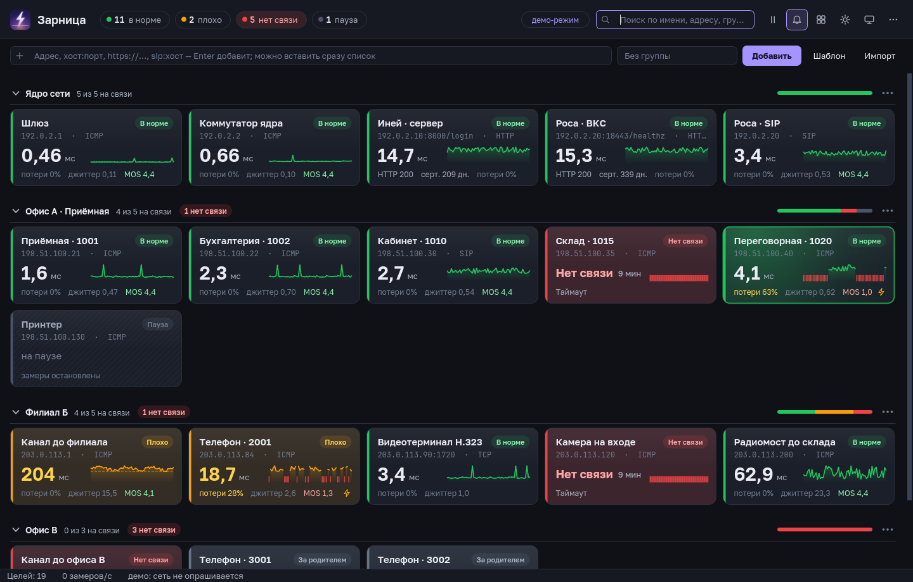

# Зарница

[](https://github.com/Rayanara13/zarnitsa/releases/latest/download/Zarnitsa_Astra_amd64.deb)

Astra Linux 1.7 · x86_64 · системный Qt 5.15

Нативный сетевой монитор для Astra Linux на Qt 5.15. Работает самостоятельно и с источниками адресов Инея и Росы.



- ICMP, TCP, HTTP(S), SIP OPTIONS и DNS.
- Плитки, таблица, графики, журнал и оповещения; светлая и тёмная темы.
- Трассировка, поиск узлов, импорт vmPing/CSV/JSON, своё API и режим без окна.
- Скрипты офлайн-поставки, установки, обновления и отката.

## Сборка

Нужны C++17, CMake 3.13+ и Qt 5.15: Core, Gui, Widgets, Network.

```sh
cmake -S . -B build -DCMAKE_BUILD_TYPE=Release -DZARNITSA_TESTS=OFF
cmake --build build --parallel
./build/zarnitsa
```

Для демонстрации: `./build/zarnitsa --demo`. Данные в ней синтетические.

[Инструкция](ИНСТРУКЦИЯ.txt) · [Условия использования](LICENSE) · [Лицензии шрифтов](resources/licenses)
